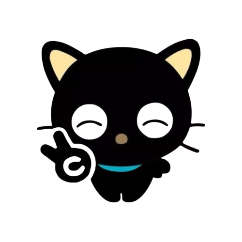
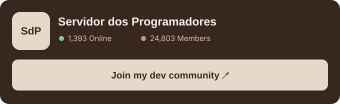
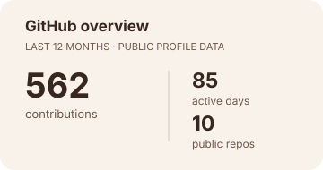
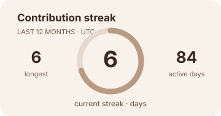
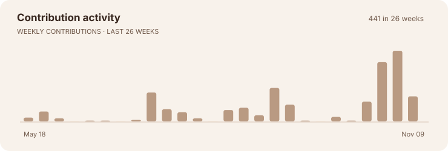

 

  

I'm Sarah Aliriel XD

Frontend Engineer & Creative Developer!

Building thoughtful digital experiences where engineering meets design.

I create responsive, accessible and engaging interfaces with a focus on thoughtful interactions, clean architecture and the little details that make products feel human.

 
 
Technologies I work with.

  
  
  
  
  
  
  

 
 

Beyond the code.
I also help nurture Servidor dos Programadores, a Brazilian developer community where people learn, share knowledge, exchange feedback and build together.

  

 
 

A little consistency goes a long way.

  
  
  
   
  
  

  
  powered by tea, curiosity & late-night ideas ♡   
  
  <a href="https://sarahaliriel.tech">developer portfolio</a> ·
  <a href="https://sarahaliriel.work">creative work</a> ·
  <a href="https://www.linkedin.com/in/sarah-aliriel-dumitrache-05aa54362">linkedin</a> ·
  <a href="https://discord.com/users/942126894478950530">discord</a> 

 
